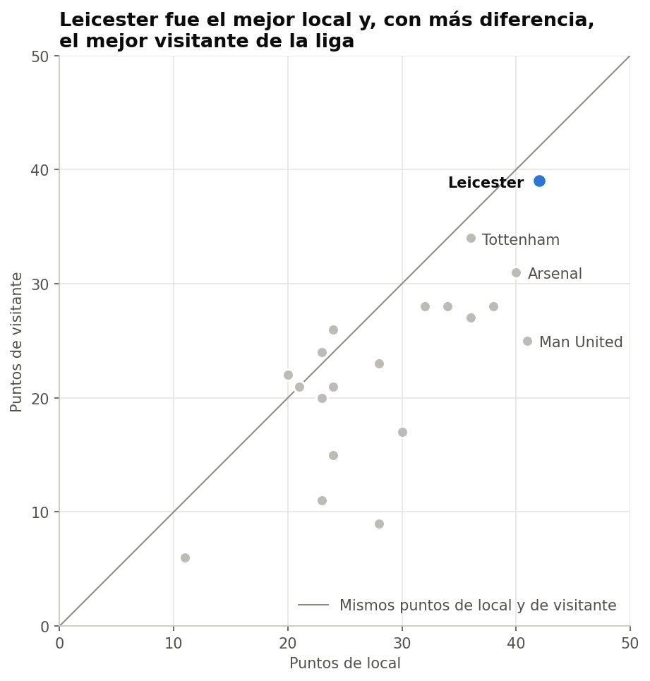
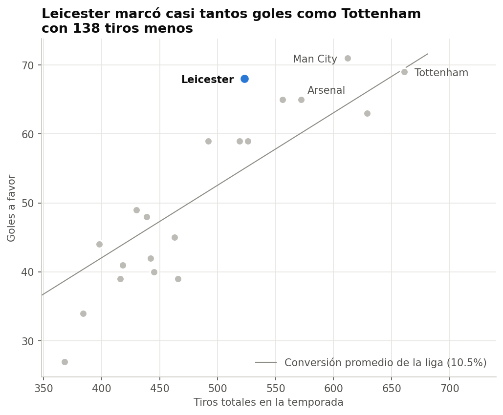

# 🏆 Leicester City 2015/16: Análisis de una temporada histórica

## 📖 Descripción del proyecto

En la temporada 2015/16, Leicester City protagonizó una de las mayores sorpresas en la historia del deporte al conquistar la Premier League inglesa. Un equipo que había luchado por evitar el descenso la temporada anterior logró superar a clubes como Arsenal, Manchester City, Manchester United y Tottenham para convertirse en campeón.

El objetivo de este proyecto es analizar los datos de la temporada 2015/16 para responder una pregunta principal:

> ¿Cómo logró Leicester City ganar la Premier League 2015/16?

Para responderla se realizó un análisis exploratorio de datos con Python y Pandas, estudiando el rendimiento del equipo desde distintas perspectivas: resultados, ataque y defensa, comparación con sus rivales, desempeño como local y visitante, eficiencia de cara al arco y expectativas de las casas de apuestas.

---

## 🎯 Objetivos

- Analizar el rendimiento general de Leicester City durante la temporada 2015/16.
- Comparar sus estadísticas con las de sus principales competidores.
- Evaluar su rendimiento como local y como visitante.
- Medir su eficiencia ofensiva.
- Contrastar sus resultados con las expectativas de las casas de apuestas (Bet365).
- Identificar los factores que explican la obtención del campeonato.

---

## 🛠️ Tecnologías utilizadas

- Python
- Pandas
- Matplotlib
- Jupyter Notebook
- Git & GitHub

---

## 📊 Dataset

- **Fuente:** paquete [English Premier League](https://datahub.io/sports-data/english-premier-league) de datahub.io, que recopila los datos de [football-data.co.uk](http://www.football-data.co.uk/).
- **Licencia:** Open Data Commons Public Domain Dedication and License (PDDL) v1.0.
- **Archivo utilizado:** `data/season-1516_csv.csv`
- **Tamaño:** 380 partidos (20 equipos, 38 fechas) y 65 columnas.

Cada registro representa un partido e incluye:

- Equipos participantes y fecha
- Goles (al final y al entretiempo) y resultado
- Tiros totales y tiros al arco
- Faltas, córners y tarjetas
- Cuotas de distintas casas de apuestas

---

## ✅ Calidad de los datos

Antes del análisis se validó lo siguiente:

- No hay registros duplicados.
- El resultado registrado (local, empate o visitante) coincide con los goles en los 380 partidos.
- No hay valores negativos en goles, tiros, faltas, córners ni tarjetas.
- Los únicos valores nulos son tres cuotas de Betway (BWH, BWD, BWA) del partido Tottenham–Newcastle del 13/12/2015. Se conservó el registro porque esas columnas no se usan en el análisis.
- Se encontró una inconsistencia: en Aston Villa vs. West Ham (26/12/2015), Aston Villa registra más tiros al arco (8) que tiros totales (5). Se conservó el registro sin modificar, porque no es posible saber qué valor es el incorrecto y el partido no afecta a los equipos analizados.

---

# 🔍 Principales hallazgos

## 1. Consistencia por encima de todo

Leicester finalizó la temporada con:

| Métrica | Valor |
|----------|----------|
| Puntos | 81 |
| Victorias | 23 |
| Empates | 12 |
| Derrotas | 3 |
| Goles a favor | 68 |
| Goles en contra | 36 |

Ganó la liga con 10 puntos de ventaja sobre Arsenal. El dato más destacado es que solo perdió 3 partidos, la menor cantidad del campeonato, mientras que los equipos que terminaron del 2° al 5° puesto registraron entre 6 y 10 derrotas.


---

## 2. No fue el mejor ataque ni la mejor defensa

Leicester no lideró ninguna de las dos estadísticas, pero estuvo entre los mejores en ambas:

- **Ataque:** 68 goles, el tercero más goleador detrás de Manchester City (71) y Tottenham (69).
- **Defensa:** 36 goles recibidos, igual que Arsenal. Solo Tottenham y Manchester United recibieron menos (35).

---

## 3. Rendimiento equilibrado como local y visitante

| Condición | Puntos | Goles a favor | Goles en contra |
|------------|------------|------------|------------|
| Local | 42 | 35 | 18 |
| Visitante | 39 | 33 | 18 |

Leicester sumó casi la misma cantidad de puntos y goles en ambas condiciones, y recibió exactamente los mismos goles de local que de visitante.

Además, fue el mejor equipo de la liga en las dos condiciones, pero la diferencia fue mucho mayor de visitante: sumó 39 puntos fuera de casa, 5 más que Tottenham (34), mientras que de local superó por solo un punto a Manchester United (42 contra 41).



---

## 4. La eficiencia ofensiva fue una de las claves

Comparación con los equipos que terminaron del 2° al 5° puesto:

| Equipo | Goles | Tiros | Conversión |
|----------|----------|----------|----------|
| Leicester | 68 | 523 | 13.00% |
| Arsenal | 65 | 572 | 11.36% |
| Tottenham | 69 | 661 | 10.44% |
| Manchester City | 71 | 612 | 11.60% |
| Manchester United | 49 | 430 | 11.40% |

*Conversión = goles / tiros totales.*

Leicester registró la mejor tasa de conversión entre estos equipos y también de toda la liga, cuyo promedio fue 10.51%. Con 138 tiros menos que Tottenham, terminó la temporada con solo un gol menos.



---

## 5. Rendimiento frente a las expectativas de las apuestas

Se consideró a un equipo favorito cuando su cuota de Bet365 era menor que la de su rival.

| Métrica | Valor |
|----------|----------|
| Partidos como favorito | 21 |
| Partidos como no favorito | 17 |
| Victorias como no favorito | 7 |
| Puntos obtenidos como no favorito | 28 |

Leicester no fue favorito en 17 de sus 38 partidos (45%) y aun así sumó 28 puntos en esos encuentros, el 34.6% de su total.

---

# 🏁 Conclusión

Los datos indican que Leicester City no ganó la Premier League 2015/16 por dominar una estadística específica, sino por combinar consistencia, equilibrio y eficiencia.

No fue el equipo más goleador ni el que menos goles recibió, pero se mantuvo entre los mejores en ambas facetas y fue el que menos partidos perdió. Fue el mejor local y el mejor visitante de la liga, con una ventaja mayor fuera de casa, necesitó menos tiros que sus rivales directos para marcar una cantidad de goles parecida y obtuvo una parte importante de sus puntos en partidos en los que no era favorito.

---

## ⚠️ Limitaciones

- Se analiza una sola temporada (38 partidos de Leicester), por lo que las diferencias entre equipos pueden estar influidas por la variabilidad propia de una muestra chica.
- El dataset no incluye métricas de calidad de las ocasiones (como goles esperados o xG). Por eso, una tasa de conversión alta no permite distinguir entre calidad de definición y variabilidad.
- La definición de favorito compara solo las cuotas de victoria de ambos equipos y no tiene en cuenta la cuota del empate.

---

## 📁 Estructura del repositorio

```
premier_league_analysis/
├── data/
│   ├── season-1516_csv.csv     # Dataset de la temporada 2015/16
│   └── datapackage.json        # Metadatos y licencia de la fuente
├── images/                     # Gráficos generados por el notebook
├── notebooks/
│   └── analysis.ipynb          # Análisis completo
└── README.md
```

---

## ▶️ Cómo ejecutarlo

1. Clonar el repositorio:
   ```bash
   git clone https://github.com/FrancoJarc/premier_league_analysis.git
   cd premier_league_analysis
   ```
2. Instalar las dependencias:
   ```bash
   pip install pandas matplotlib jupyter
   ```
3. Abrir `notebooks/analysis.ipynb` y ejecutar todas las celdas en orden (Restart & Run All).

---

## 👤 Autor

**Franco Jarc** · [GitHub](https://github.com/FrancoJarc)
